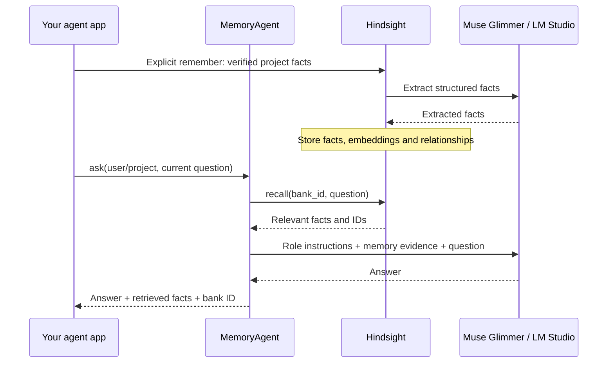

# How this agent uses memory

The sample wraps a LangChain chat model with a persistent-memory step. Muse Glimmer generates the answer; Hindsight supplies facts from earlier interactions. There is one model invocation per question, with no autonomous planning/tool loop in this sample.

## Before answering

`Scope(user, project)` determines the memory bank. Planner and coder use the same bank when their user/project match. A different user or project gets a different bank. Your actual app must obtain these identities from its authenticated request; the example CLI is not an authorization system.

Scope IDs are used for retrieval routing; the wrapper does not automatically tell the model the user's display name. If memories mention a named person, include the relevant authenticated identity in the agent's instructions. The benchmark explicitly identifies Alice or Bob in every comparison mode: its initial ambiguous prompts led to abstentions even when the facts were supplied directly.

`MemoryAgent.ask()` calls `MemoryService.recall()` using the current question. In this sample, recall uses a low search budget and a 1,200-token evidence limit. The server retrieves and ranks stored facts. The benchmark's server logs showed query embedding, semantic/keyword/graph retrieval, result merging, cross-encoder reranking, and token filtering.

The wrapper sends three messages to the model: role instructions, retrieved facts as JSON evidence, and the current question. Memory is labeled as untrusted evidence. It does not change the model's weights. The answer includes the exact facts supplied so you can inspect whether a response was grounded in memory.

## When memory changes

Only an explicit `remember` call writes data. The `--agent planner` argument records the source role; it does not ask a planner model to generate the stored fact. Hindsight's extraction model processes that supplied content. The call waits for ingestion before returning.

Ordinary `ask` calls do not save prompts or generated answers. In a real app, retain confirmed preferences, accepted decisions, and validated task outcomes at suitable workflow steps. Reuse a document ID when replacing its source content. Keep speculative assistant output out of the fact store.

## What the comparison means

- **Without memory:** the same model receives the current question and empty evidence. It should admit it cannot know an arbitrary past decision.
- **With Hindsight:** the model receives facts retrieved from the earlier source, even though the current request has no conversation history.
- **With supplied context:** the app puts the original source directly in the prompt. This tests whether retrieval is necessary for this small amount of context.

Hindsight's benefit here is persistence and recall across sessions and agents. It adds a memory-write cost, retrieval work, and evidence tokens. If your application already includes all necessary facts in every prompt, this test does not establish an additional answer-quality benefit from Hindsight. Larger histories, conflicting updates, and unrelated memories need separate evaluations.

## Applying the pattern to your current agents

Keep each agent's tools, task instructions, and short-term conversation/checkpoint state. Add a recall step before its invocation and pass the evidence into its state or messages. Add explicit retain calls after confirmed decisions or successful actions. The README includes an adapter for agents that accept a `{"messages": ...}` state dictionary.

This benchmark exercises the model wrapper and memory boundary. It does not execute your existing agents' business tools, LangGraph checkpoints, or Pydantic AI workflows.
