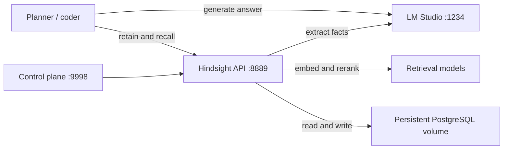

# Hindsight memory agents

Persistent project memory for local LangChain agents, using Hindsight and an OpenAI-compatible model endpoint such as LM Studio. A planner and coder share confirmed decisions across fresh processes. Includes SDK, LangGraph, and Pydantic AI learning labs and the preserved local benchmark.

## Architecture



The wrapper recalls evidence before each model call. Only explicit `remember` commands write data. Scope is a user/project pair; roles within that scope share a bank. The CLI demonstrates routing, not authentication. See [the walkthrough](HOW_IT_WORKS.md).

## Quick start

Requires Git, Python 3.12, [uv](https://docs.astral.sh/uv/), Docker Desktop, and LM Studio. Install/load Muse Glimmer 30B UD Q6_K_XL in LM Studio, expose it as `muse-glimmer-30b`, and start its OpenAI-compatible server on port 1234. The recorded run loaded 16,384 context tokens on an M4 Max with 64 GiB RAM. Another model can be selected in `.env`, but its behavior and timings will differ.

```sh
git clone https://github.com/binzhango/hindsight-memory-agents.git
cd hindsight-memory-agents
uv sync --frozen
cp .env.example .env
docker compose up -d
uv run memory-agents doctor
```

`uv` fetches the Hindsight SDK from a pinned upstream Git revision; you do not need a local Hindsight checkout. The server image is independently pinned by digest in `compose.yaml`. Embeddings/reranking use the image defaults; extraction and answering use LM Studio. Observations and automatic consolidation are disabled for this introductory experiment. Fresh setup needs network access for dependencies, the image, and model artifacts.

The Python client uses `localhost:1234/v1`; the container reaches LM Studio at `host.docker.internal:1234/v1`. This Compose configuration targets Docker Desktop on Mac. Confirm that the container can reach LM Studio before ingestion. If authentication is enabled, set `LM_STUDIO_API_KEY` in `.env`. Never commit that file. For an externally authenticated Hindsight service, also configure `HINDSIGHT_URL` and `HINDSIGHT_API_KEY`.

API: http://localhost:8889 · Control plane: http://localhost:9998

`doctor` checks health and model discovery, not successful extraction. The Compose project name remains `lmstudio-memory-demo`, preserving the original demo volume when migrating on the same machine. Do not launch both copies simultaneously. `docker compose down` preserves memory; adding `-v` intentionally deletes its volume.

## Remember in one process, recall in another

```sh
uv run memory-agents remember \
  'For this project Alice requires Python, SQLite, and no paid external APIs.' \
  --user sample-alice --project lmstudio-demo \
  --agent planner --document-id project-constraints

uv run memory-agents recall 'What are the project constraints?' \
  --user sample-alice --project lmstudio-demo

uv run memory-agents ask \
  'I am Alice. Suggest a minimal implementation stack for this project.' \
  --user sample-alice --project lmstudio-demo --agent coder
```

Each command is a fresh process. The answer includes the bank ID and retrieved evidence. `--agent planner` on `remember` records a source label; it does not generate or validate the stored statement. Reuse a document ID to replace that source. Change the user or project to route to another bank. Add `--no-memory` to `ask` to skip retrieval.

The wrapper does not automatically tell the model the caller's display name. Provide relevant authenticated identity in application instructions; the explicit Alice wording above avoids the ambiguity found in an exploratory pilot.

## Integrate an existing LangChain agent

This is an application composition excerpt; provide your own existing agent, session, scope, and question:

```python
from langchain_core.runnables import RunnableLambda
from memory_agents import MemoryAgent, MemoryService, Scope, Settings

settings = Settings.from_env()
memory = MemoryService(settings)

async def invoke_existing(messages):
    result = await existing_agent.ainvoke(
        {"messages": messages},
        config={"configurable": {"thread_id": session_id}},
    )
    return result["messages"][-1]

try:
    augmented = MemoryAgent(RunnableLambda(invoke_existing), memory, instructions)
    answer = await augmented.ask(scope, question)
finally:
    await memory.close()
```

Resolve scope and checkpoint identity from the authenticated request. Keep existing tools and task instructions. Manage replacement of injected evidence in checkpointed conversations, and avoid duplicate recall if another middleware already supplies memory. Retain confirmed decisions and validated outcomes explicitly. Memory failures surface rather than silently producing a memory-free answer; a missing first-time bank returns empty evidence.

## Optional Jev preflight and answer review

Install `uv sync --frozen --extra jev` and set `TYPESAFE_API_KEY` in `.env`.
`--jev` sends the question, agent instructions, selected memory facts and generated
answer to the hosted TypeSafe service. Use synthetic fixtures when exploring.
The default path makes no Jev calls.

```sh
uv run --extra jev memory-agents ask \
  'I am Alice. Suggest a minimal implementation stack for this project.' \
  --user sample-alice --project lmstudio-demo --agent coder --jev
```

One recall snapshot feeds both Jev and the worker. Jev chooses `proceed`, `clarify`
or `review` before generation, then assesses the draft against the same evidence.
Python routes confidence below 0.60 to review. This is an illustrative, uncalibrated
threshold. A blocked draft appears only in `draft`, never as the accepted `text`.
Provider failures fail the command visibly. These are answer-level gates: a review
result is a handoff signal, not an implemented human approval queue. Do not wrap a
tool-executing agent and assume post-answer review prevents earlier side effects.

Compare the four configurations using `ask`, `ask --no-memory`, `ask --jev`, and
`ask --no-memory --jev`. No combined live accuracy benchmark has been run.
The existing benchmark runner and historical scores cover memory only.
Mocked tests check routing, one-snapshot evidence sharing, failure propagation,
and separation of rejected drafts. They do not establish Jev accuracy.
Explicit `remember` remains the only write path; generated answers are not retained.

### Inspect deterministic decision traces

```sh
uv run python labs/decision_lab.py --output benchmarks/my-decision-lab/results.json
```

This executes the actual wrapper with scripted memory, worker, and decision providers.
Nine cases cover accepted/rejected drafts, clarification, both sides of the confidence
threshold, preflight/review timeouts, memory-only, and Jev without memory. The JSON
records every event and output. The preserved run is in `benchmarks/decision-lab`.
These are control-flow observations with zero live model calls, not accuracy results.

## Learning labs

[The labs](labs/README.md) include a live SDK retain/recall/reflect script and a deterministic framework exercise covering LangChain tools, a compiled LangGraph, and Pydantic AI:

```sh
uv sync --frozen --extra labs
uv run --extra labs python labs/framework_lab.py
```

The framework lab mocks the memory service and uses Pydantic AI's test model. It verifies wiring, not live model quality or backend authorization.

## Benchmark and checks

```sh
uv run pytest -q
uv run ruff check src tests labs
uv run ruff format --check src tests labs
uv run python -m memory_agents.benchmark --output benchmarks/my-run --repeats 2
```

Use a new output directory for every benchmark. It creates a synthetic memory bank and leaves it for inspection. The preserved November 5, 2026 run made 36 requests (six cases, three modes, two repeats):

| Mode | Stored facts | Unknown/scope | Median answer latency |
| --- | ---: | ---: | ---: |
| No memory | 0/8 | 4/4 | 6.80 s |
| Hindsight | 8/8 | 4/4 | 16.32 s |
| Source in prompt | 8/8 | 4/4 | 15.72 s |

Read the [methodology and pilots](benchmarks/README.md), [report](benchmarks/2026-11-05-local/REPORT.md), and [raw results](benchmarks/2026-11-05-local/results.json). These are historical measurements from the original local environment, not a new run after extraction. The final cases reuse the pilot questions. The result demonstrates recovery of stored facts, not better general coding ability or secure multi-tenant isolation.

## Source and provenance

- [Agent wrapper](src/memory_agents/app.py), [CLI](src/memory_agents/cli.py), [benchmark runner](src/memory_agents/benchmark.py)
- [Original live verification](VERIFICATION.md)
- [Extraction notes](MIGRATION.md)
- [Hindsight upstream](https://github.com/vectorize-io/hindsight)

MIT licensed; the upstream Vectorize notice is retained in LICENSE.
